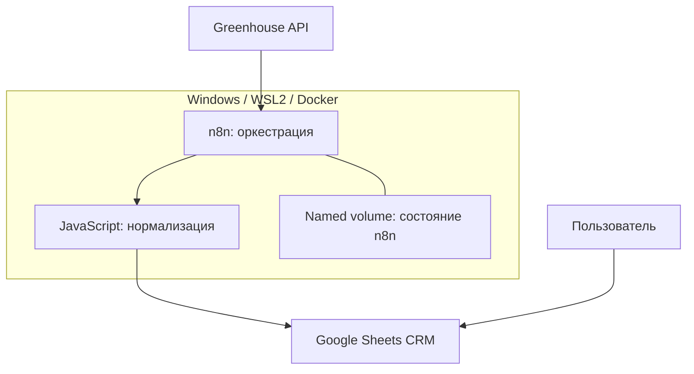

# Текущая архитектура (as-is)

> Обновление 29.10.2026: получены экспорт и точный JS. Актуальные подтверждения, ограничения и результаты 12 тестов — [аудит экспорта](../audit-workflow-export.md). Противоречащие ему утверждения ниже об отсутствии workflow/кода относятся к первоначальному срезу. Baseline gate ещё не закрыт.

Статус: компоненты подтверждены пользователем; параметры — по E1; точные связи узлов n8n требуют экспорта.

Логический flow: запуск → получение вакансий Greenhouse → нормализация → сопоставление vacancy_id → вставка новых / обновление существующих → last_seen_at. Реализация может использовать один upsert node или отдельные ветви: это неизвестно. Trigger и порядок промежуточных узлов не восстановлены по догадке.

## Границы и ответственность

| Компонент | Ответственность | Чего не подтверждает |
|---|---|---|
| Greenhouse | Данные источника | Пригодность роли кандидату, гарантированную свежесть |
| n8n | Запуск и интеграции | SaaS tenant isolation |
| JavaScript | Приведение формата | Полную валидацию и точность классификации |
| Google Sheets | Хранилище вакансий и интерфейс CRM | Транзакционный upsert и ограничения unique |
| Docker volume | Состояние n8n | Независимую резервную копию |

Две разные плоскости хранения: внутренняя база n8n для workflows/credentials/executions и Sheets для продуктовых данных. Будущая продуктовая PostgreSQL не подразумевает использование внутренних таблиц n8n.

## Сеть

По E1 порт 5678 привязан к 127.0.0.1. localhost в облачной среде не является компьютером пользователя. Не открывать порт и не вводить туннель ради аудита. Материалы передаются экспортом файлов. Доступ к API и Google инициируется локальной системой; OAuth уже проходил локально по E5.

## Эксплуатационные ограничения

Сбор зависит от работающего ПК, Docker, сети и сна Windows. restart: unless-stopped не решает сон устройства. Europe/Sofia — timezone конфигурации, timestamp для обмена хранить с offset/UTC. Наличие schedule в JSON не доказывает activation trigger. Рабочий источник настроек до JR-003 неизвестен.

## Срез v0.5 — 2026-10-29

v0.4 проверен пользователем на реальных n8n 2.45.5 и рабочей Google Sheets:
повторные запуски без дублей, last_seen обновляется, first_seen сохраняется.
first_seen создаётся только для новых ID, исторические пустые значения не заполняются.

В v0.5 добавлен локальный Windows Task Scheduler → Node runner с эксклюзивным
файловым lock → временный webhook workflow n8n → текущий Greenhouse/Sheets pipeline.
Пустой результат получает явное подтверждение. Отчёт содержит runId, этапы, время,
счётчики и исход; неизвестный результат удерживает lock. Облако не обращается к localhost.
Docker остаётся прежним. Это реализовано, но новый runtime путь ещё требует локальной
проверки; [инструкция](../operations/scheduled-collector-v0.5.md), [ADR 007](../adr/007-local-scheduled-writer.md).

## Runtime evidence и APP-01 — 2026-10-29

Пользователь подтвердил первый scheduled production run v0.5: 190/15/0/15
(total/matched/inserted/updated), cleanup completed, lock null, Windows task result 0.
Значит, test-first installer и Windows execution проверены; повторяемость следующего
трёхчасового интервала отдельно не подтверждалась.

APP-01 добавляет изолированное чтение требований формы и controlled HTTP fixture.
Никакой application worker не включён в scheduled collector, реальная отправка
к работодателю не реализована. [Evidence и ограничения](../research/application-channel-spike.md).

## v0.6 — source expansion после пользовательского пересмотра приоритета

Source registry → два Node read adapters (Greenhouse/Lever) → role/geography policy →
объединённый payload → один temporary n8n writer → прежняя Google Sheets CRM.
Read phase и write phase защищены прежним локальным lock. Failure одного board даёт
явный partial; all failed не создаёт writer. First_seen/upsert и original Airbnb IDs
сохранены. География/reasons — в локальном HTML/JSON каталоге, новых Sheets колонок нет.
Legacy v0.5 runner сохранён; browser/application spike не включается в поиск/отклики.
[ADR 010](../adr/010-multi-source-catalog.md), [операции](../operations/multi-source-v0.6.md).

## v0.6.1 — remote evidence и основной view

Description-aware work mode policy remote-evidence-v1 добавляет main/unclear/excluded
и короткое evidence к локальному каталогу. Основной HTML view требует подтверждённого
remote без выявленных country restrictions. Ролевой writer и историческая CRM сохранены;
это не фильтрация last_seen/закрытие записей. [ADR 011](../adr/011-confirmed-remote-main-view.md).

## v0.7.0 — MATCH-01, первая итерация

После нормализации чистая функция сопоставляет профиль с названием, форматом и явными языковыми сигналами. Выход — объяснимый приоритет просмотра; бизнес-данные Sheets не меняются. Полный каталог получает profile fingerprint для воспроизводимости.

Read-only preview дополнительно строит сбалансированный review snapshot и отдельный offline HTML. Оценки хранятся в браузере с JSON export/import; CLI сводит их только с исходным локальным снимком. Нет сервера, LLM, новой БД или передачи оценок третьим лицам. [ADR 012](../adr/012-explainable-matching-review.md).

## v0.7.1 — исправления после первой разметки

Чистые правила geography remote-bg-v2 уточняют приоритет условий конкретной позиции, optional hybrid и страны найма. Стек и writer сохраняются. Review HTML показывает текст сразу; общий валидатор v1/v2 используется в браузере и CLI. Частичные оценки сохраняются, старые JSON не переписываются. `matching:report -- FILE --open` пересоздаёт только HTML старого снимка с загруженными оценками; для пересчёта выдачи нужен новый preview. [ADR 013](../adr/013-role-conditions-and-review-dimensions.md).
