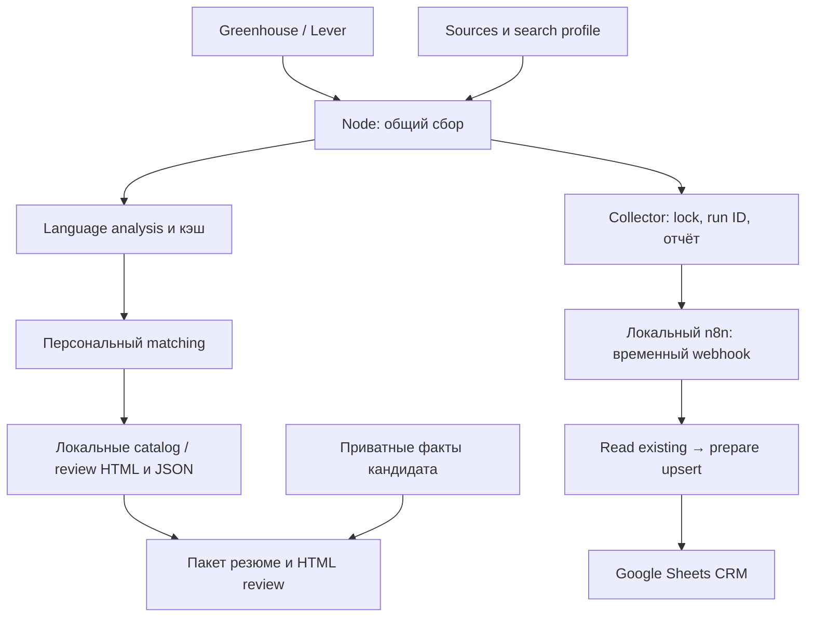

# Текущая архитектура

Основа проверена по commit `be5dafe`; Language Intelligence v1 добавлен в рабочей ветке 2026-11-04. Статус выпуска/установки ведётся в [roadmap](../product/roadmap.md), пути и тесты — в [карте кода](codebase-map.md). Это описание существующего single-user решения; [evolution](evolution.md) описывает целевую архитектуру.

## Компоненты и поток данных

- **Sources** читает публичные API, проверяет полноту/формат и формирует scoped ID. Ошибка одного источника не превращается в пустой успешный feed. Конфигурация находится в `config/sources.json`.
- **Language enrichment** выделяет язык публикации, обязательные/желательные требования и язык команды с evidence. Общий анализ не зависит от пользователя: rules по умолчанию, optional AI provider, кэш и ограниченные retries. **Matching** рассчитывает Language Fit отдельно по search profile, наряду с ролью, seniority и географией. Объяснения и rank boost не являются вероятностью трудоустройства. [Контракт/эксплуатация](../operations/language-intelligence.md), [ADR 015](../adr/015-language-intelligence.md).
- **Collector** на Node собирает источники, проверяет payload, создаёт временный workflow, активирует, вызывает webhook и проверяет completion. Затем деактивирует и удаляет workflow. На неоднозначном исходе сохраняет lock для проверки человеком.
- **Storage preparation** читает существующие ID; при вставке задаёт first_seen_at, при update не передаёт его. Google Sheets node выполняет appendOrUpdate по vacancy_id. При opt-in языковых колонок добавляется чтение записанных JSON и сверка значений; автоматическое создание колонок запрещено. Детали и ограничения — [контракты](../contracts.md).
- **Reports** создаёт автономный HTML и JSON в `.collector-state/`. Remote-фильтр основного обзора не отбрасывает ролевые строки из CRM. Review связывает пользовательские оценки с конкретным snapshot.
- **Resumes** читает приватный профиль фактов и выбранную вакансию; формирует версионированный пакет, выбор фактов, preview и HTML export. Черновик сохраняется локально и переносится JSON с проверкой hash. Отбор/порядок фактов — без генерации новых утверждений; approval экспорта не является разрешением отправить отклик.
- **Applications** — изолированный прототип HTTP/browser на fixtures и read-only inspection. Он не подключён к production-отправке работодателям.

## Границы кода и n8n

`src/` содержит бизнес-правила и renderers, `scripts/` — CLI, I/O и сборку workflow. Постоянного API-сервера, фонового Node-сервиса и frontend build pipeline нет. `package.json` определяет команды; CommonJS использует встроенные Node API. ESLint — зависимость разработки, Playwright вынесен в `browser/`.

В репозитории три вида workflow-артефактов:

| Артефакт | Назначение |
|---|---|
| `workflows/*.sanitized.json` | Исторический экспорт исходной цепочки Manual → HTTP → Code → Sheets; доказательство baseline |
| `workflows/*.validation-v0.3.json`, `*.first-seen-v0.4.json` | Производные legacy-цепочки из JS; сборка через `workflow:build`. Вторая добавляет чтение таблицы и storage preparation |
| Генераторы в `scripts/` | Runtime scheduled/multi-source и integration workflow. В multi-source данные уже собраны Node, n8n отвечает за локальную запись и summary |

Multi-source — обычный путь `collector:run`; legacy Airbnb сохраняется отдельной командой. Изменение общего storage-кода влияет и на производные workflow, и на runtime builders: проверять оба пути.

## Инфраструктура и интеграции

- Windows/WSL2, Docker и n8n на loopback; артефакт Compose — `infra/local/docker-compose.yml`. Там используется `n8n:stable`, а не зафиксированный digest. Нельзя считать версию установленного контейнера известной по этому тегу.
- Windows Task Scheduler вызывает collector раз в три часа при входе пользователя. Docker/n8n должны работать; это не облачный scheduler.
- Sheets — проекция каталога с ручными CRM-полями. n8n хранит свои credentials/state в volume; это не продуктовая БД.
- Greenhouse/Lever — публичное чтение. Справочник endpoint/данных/retry: [source coverage](../research/source-coverage-v0.6.md#справочник-существующих-адаптеров).
- n8n REST API управляет временным workflow; Google Sheets node использует credential владельца. Настройка и разделение тестовых ресурсов — [integration tests](../operations/integration-tests.md).
- GitHub Actions проверяет Node и browser fixtures. Deployment локальной установки остаётся отдельным действием; [CI](../operations/ci.md).

## Ограничения

Lock защищает только запуски данного runner из одного рабочего каталога. Другой экземпляр/ручной workflow может обойти его; Sheets не даёт транзакционного upsert. Нет автоматического подтверждения закрытия исчезнувших вакансий, semantic dedup между объявлениями и защиты timestamp от уменьшения при старом событии.

HTML/localStorage и локальные JSON не заменяют durable product storage. Нет PostgreSQL, auth/tenant isolation, AI-перефразирования, автоматического PDF renderer или подтверждённого live Submit. Эти компоненты нельзя считать реализованными из-за наличия target schema или spike.

Изменение инфраструктуры, реальная отправка и второй пользователь требуют отдельных решений и проверок по roadmap. Исторические аудиты и release notes сохраняются как датированные доказательства; их ограничения не переопределяют текущий код.

