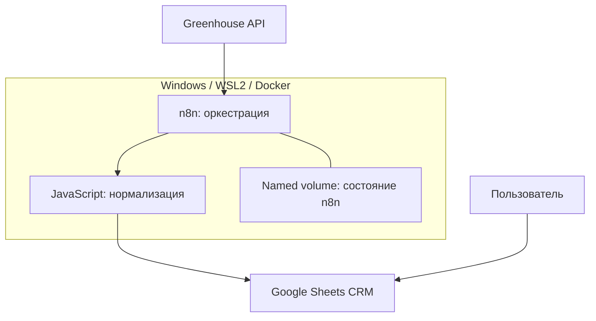

# Текущая архитектура (as-is)

> Обновление 29.10.2026: получены экспорт и точный JS. Актуальные подтверждения, ограничения и результаты 12 тестов — [аудит экспорта](../audit-workflow-export.md). Противоречащие ему утверждения ниже об отсутствии workflow/кода относятся к первоначальному срезу. Baseline gate ещё не закрыт.

Статус: компоненты подтверждены пользователем; параметры — по E1; точные связи узлов n8n требуют экспорта.

Логический flow: запуск → получение вакансий Greenhouse → нормализация → сопоставление vacancy_id → вставка новых / обновление существующих → last_seen_at. Реализация может использовать один upsert node или отдельные ветви: это неизвестно. Trigger и порядок промежуточных узлов не восстановлены по догадке.

## Границы и ответственность

| Компонент | Ответственность | Чего не подтверждает |
|---|---|---|
| Greenhouse | Данные источника | Пригодность роли кандидату, гарантированную свежесть |
| n8n | Запуск и интеграции | SaaS tenant isolation |
| JavaScript | Приведение формата | Полную валидацию и точность классификации |
| Google Sheets | Хранилище вакансий и интерфейс CRM | Транзакционный upsert и ограничения unique |
| Docker volume | Состояние n8n | Независимую резервную копию |

Две разные плоскости хранения: внутренняя база n8n для workflows/credentials/executions и Sheets для продуктовых данных. Будущая продуктовая PostgreSQL не подразумевает использование внутренних таблиц n8n.

## Сеть

По E1 порт 5678 привязан к 127.0.0.1. localhost в облачной среде не является компьютером пользователя. Не открывать порт и не вводить туннель ради аудита. Материалы передаются экспортом файлов. Доступ к API и Google инициируется локальной системой; OAuth уже проходил локально по E5.

## Эксплуатационные ограничения

Сбор зависит от работающего ПК, Docker, сети и сна Windows. restart: unless-stopped не решает сон устройства. Europe/Sofia — timezone конфигурации, timestamp для обмена хранить с offset/UTC. Наличие schedule в JSON не доказывает activation trigger. Рабочий источник настроек до JR-003 неизвестен.
