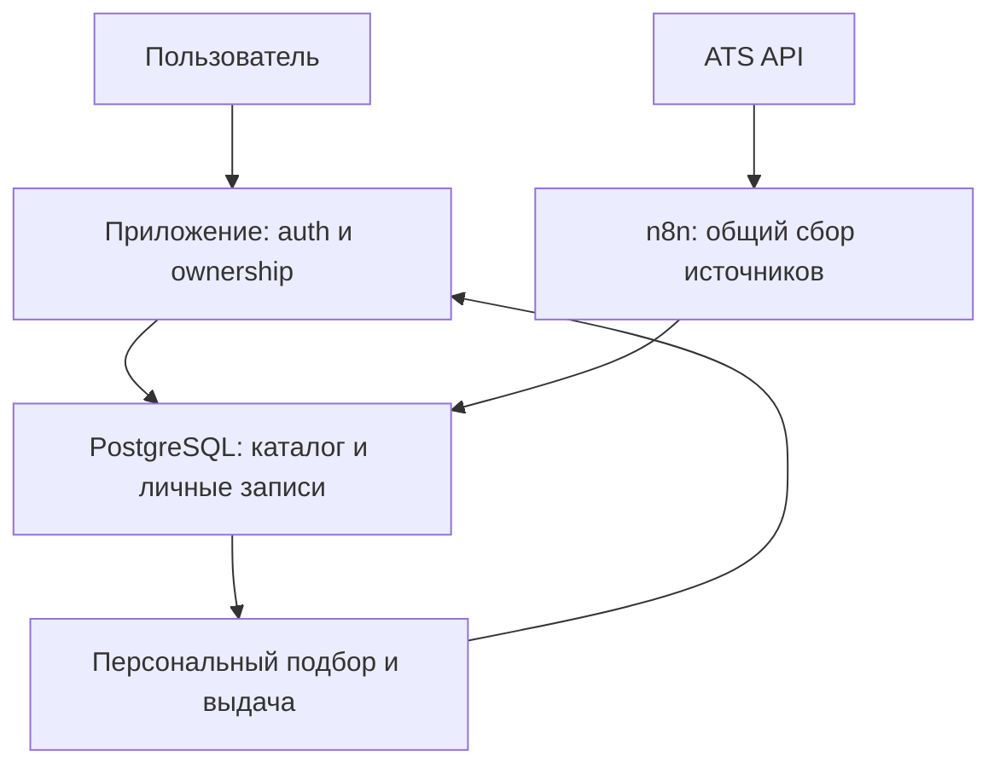

# Эволюция архитектуры (to-be, не реализовано)

Принцип: один deployment и явные модули. Микросервисы, Redis, queue mode и Kubernetes сейчас не нужны. n8n сохраняется как оркестратор, его замена требует измеренной причины.

## Шаги и триггеры

| Стадия | Конструкция | Условие перехода |
|---|---|---|
| Сейчас | Локальный n8n + Sheets | Снять baseline, пройти восстановление и повторный прогон |
| Укреплённый single-user | Тот же стек, версионированный workflow, контракты, журнал запусков | Подтверждена полезность подбора и необходимость пилота |
| Закрытый multi-user pilot | Один backend + PostgreSQL для продукта, n8n как worker, минимальный UI | До подключения второго пользователя — auth, ownership, isolation tests |
| Hosted service | Управляемый постоянно включённый deployment | Нужна работа без ПК; backup, monitoring и безопасные secrets готовы |
| Рост | Масштабирование по измерениям | Lag, p95 времени прогона, ошибки/квоты или стоимость нарушают выбранный SLO |

Pilot: одна общая загрузка вакансии на source board, затем персональные match/CRM записи. Не делать новый Greenhouse fetch для каждого кандидата. Разные credentials и пользовательские данные остаются в приватном контуре.

Это логическая схема: физический процесс matching и интерфейс записи из n8n выбираются перед пилотом, не считаются существующими.

## Миграция без потери CRM

1. Экспортировать Sheets со всеми ручными полями и сделать backup n8n. Зафиксировать количество строк, уникальные ID, timestamps и дубли заголовков.
2. Подготовить staging import: legacy vacancy_id → source identity, приватные заметки → owner. Не генерировать новые ID существующим вакансиям.
3. На время cutover остановить writer. Импортировать каталог и личные записи; неоднозначные строки отправить в quarantine с отчётом, не удалять.
4. Сверить количество уникальных вакансий, связи и выборку всех типов ручных статусов. Проверить повтор import без дублей и восстановление timestamps.
5. Переключить одного writer. Sheets сначала остаётся read-only экспортом. Не вводить неподконтрольную двустороннюю синхронизацию.
6. При расхождении остановить новый writer, вернуть прежний с восстановленным snapshot; новые CRM изменения за окно cutover перенести отдельно. До этого определить допустимые RPO/RTO и окно обслуживания.

Лицензионную применимость n8n к конкретному UX проверять до продажи пилота; профиль поиска пользователя не следует автоматически считать разрешённой конфигурацией workflows. Источники и условия использования — docs/references.md.

## Уточнение scope 29.10
Генерация резюме и автоотклики входят в core scope по решению пользователя. Перед автоматической отправкой нужна продуктовая DB для application state и атомарных ограничений; миграция каталога при этом может быть отдельной. Текущий read pipeline сохраняется. Полные требования APP-01–14 находятся в актуальном JobRadar Competitive Audit v0.2; baseline ZIP v0.1 их не содержал.
